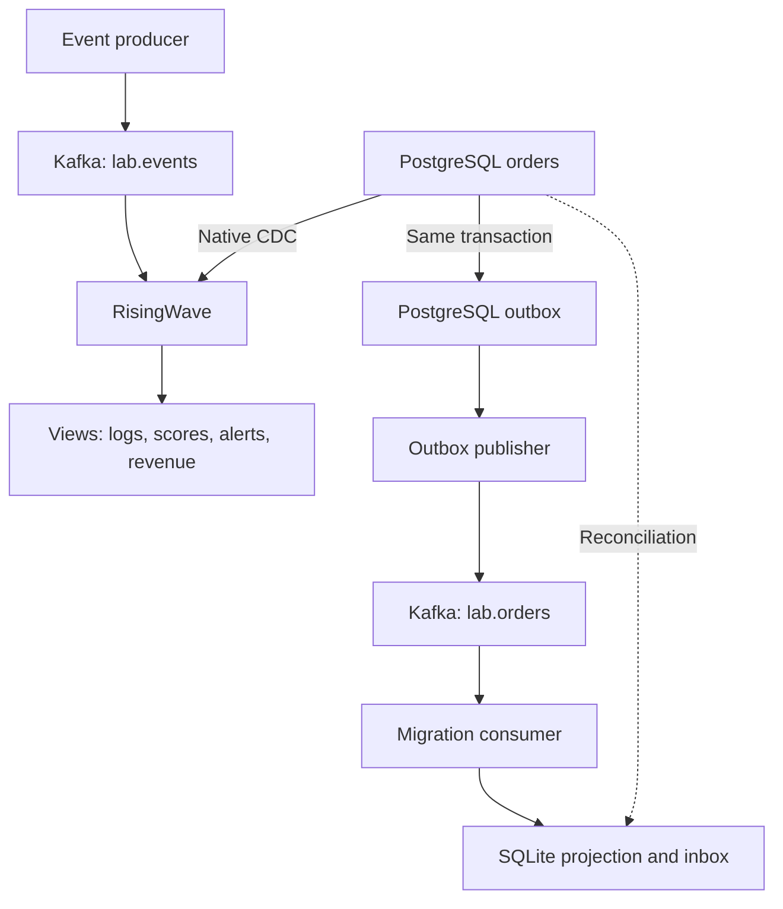
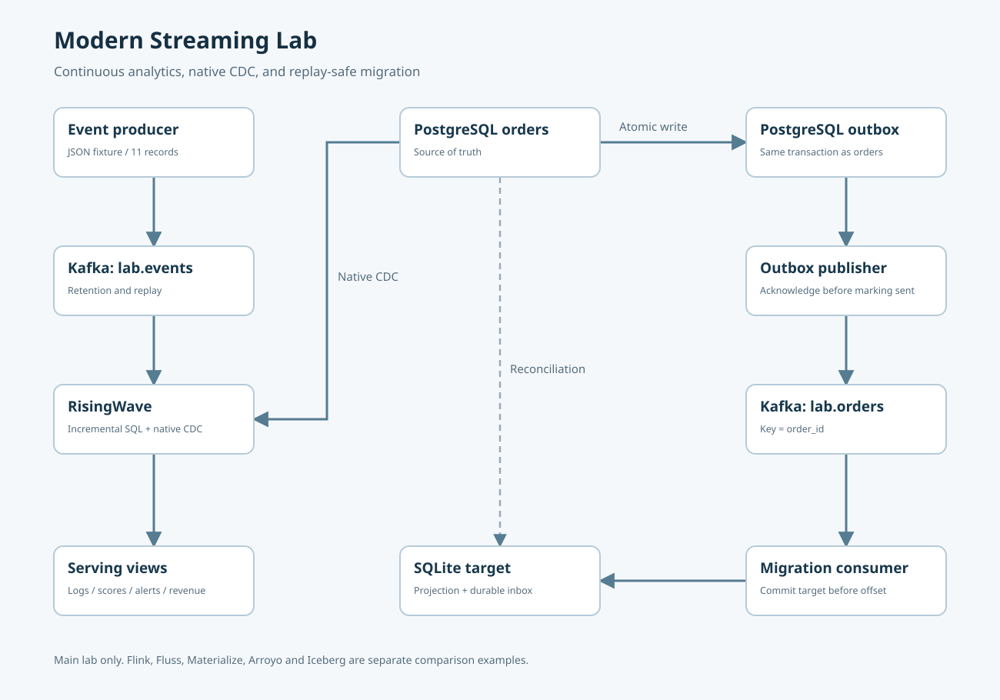

# Kafka Lab: Modern Streaming

Kafkaの5つの用途を、RisingWave・PostgreSQL・Pythonで実装する学習リポジトリ。
Flink、Apache Fluss、Materialize、Arroyo、Icebergの比較実装も収録しています。

[](https://github.com/hjosugi/kafka-lab/actions/workflows/ci.yml)
[](https://github.com/hjosugi/kafka-lab/releases)
[](LICENSE)

**主要5用途の実装、比較例、日本語解説、構成図、障害復旧試験、英語面接スクリプトを収録。**
確認日: 2026-09-06。[検証記録](docs/validation.md)で実行結果と保証の範囲を確認できます。
初めてなら[学習ロードマップ](docs/learning-path.md)、起動に困ったら[実行・復旧ガイド](docs/operations.md)へ。

## 最初に動かす

Docker Engine / Docker Desktop と `docker compose`（v2以降）を用意してください。
主要構成の目安は4 CPU・メモリ8 GB以上、Flussも動かす場合は16 GB以上です。
これは設計上の目安で、実測値ではありません。最初の実行はイメージとPython依存を取得します。
Linux/macOSはBash、WindowsはWSL2から実行できます。

```bash
git clone https://github.com/hjosugi/kafka-lab.git
cd kafka-lab
bash scripts/lab.sh demo
bash scripts/lab.sh query
bash scripts/lab.sh replay
bash scripts/lab.sh verify
```

`demo` はトピック作成、SQL登録、11件のイベント送信、注文のINSERT/UPDATE/DELETE、
outbox配送、CDC反映待ち、旧DBと移行先の全行照合、Kafka replay後の再照合を行います。
初回の空データ専用です。成功時の期待メッセージ:

```text
PASS: logs, recommendations, alerts, CDC, migration reconciliation
Replaying retained Kafka records: 5
PASS: logs, recommendations, alerts, CDC, migration reconciliation
```

Dockerなしで実行できる参照計算とテスト:

```bash
bash scripts/lab.sh offline
bash scripts/lab.sh test
```

これはPython標準ライブラリで動く参照計算・SQLiteテストです。Kafka/RisingWaveをエミュレートするものではありません。

停止時はデータを残します。最初からやり直す場合だけ、このラボのvolumeを削除します。

```bash
bash scripts/lab.sh down
bash scripts/lab.sh reset --delete-lab-data
bash scripts/lab.sh demo
```

## 主要構成





[保存用SVG](docs/diagrams/main.svg) / [PNG](docs/diagrams/main.png) / [各方式の構成図](docs/architecture.md)

## 5つの実装と期待値

| 用途 | 実装 | 期待する結果 |
|---|---|---|
| ログ分析 | Kafka → RisingWave `log_counts` | checkout ERROR=3、INFO=1、catalog INFO=1 |
| 推薦 | 重み付き行動集計 `recommendation_scores` | u1/books=9、u1/music=1、u2/music=5 |
| 監視・アラート | イベント時刻の分単位集計 `alerts` | checkoutは4件中3件ERRORで対象 |
| CDC | PostgreSQL logical replication → `cdc_orders` | 注文更新・削除が結果に反映 |
| 移行 | transactional outbox → Kafka → SQLite | 1001=1800、1003=700、1002は削除 |

推薦は説明しやすいルール型スコアです。学習済みモデル、vector search、オンライン学習は含みません。
アラートは判定結果をSQLで参照する実装です。外部への通知は送りません。
[テストデータ](data/events.jsonl) / [注文変更](data/order_changes.json) / [期待値](data/expected.json)

## 新しい構成との比較

| 方式 | このリポジトリで試せる内容 | 手順 |
|---|---|---|
| RisingWave | Kafka取り込み、継続集計、直接CDC、SQL参照 | 本文の `demo` |
| Flink | Kafka、event time、watermark、tumbling window、checkpoint、Kafka出力照合 | [Flink](examples/flink/README.md) |
| Fluss + Flink | 主キー付きstorage、継続集計、更新・削除 | [Fluss](examples/fluss/README.md) |
| Materialize | 同じKafkaイベントをSQLで継続集計 | [Materialize](examples/materialize/README.md) |
| Arroyo | KafkaのERRORイベントを別トピックへ抽出 | [Arroyo](examples/arroyo/README.md) |
| Iceberg + DuckDB | 同じfixtureを実Icebergテーブルへ保存・照会 | [Iceberg](examples/iceberg/README.md) |

比較例の自動検証は、主要デモ実行後に `python3 scripts/compare.py flink` / `materialize` / `arroyo` を使います。
Flussは独立した新規環境で `python3 scripts/compare.py fluss` を実行します。
Flinkは11件の物理入力を使うため、Arroyoや`events` / `recovery`による再送より先に実行してください。

比較例は別々に起動します。全製品を直列接続した巨大なパイプラインではありません。
Iceberg例は有限データの書き込みで、RisingWave→Icebergの常時ストリーミングsinkは構成解説の対象です。

## 読む順番

1. [5用途の解説](docs/use-cases.md)
2. [アーキテクチャと選定](docs/architecture.md)
3. [配送保証・障害・移行手順](docs/semantics.md)
4. [バージョンと公式情報](docs/versions.md)
5. [実行・復旧・運用](docs/operations.md)
6. [学習ロードマップと設計演習](docs/learning-path.md)
7. [英語面接スクリプト](docs/interview.md)

## 接続先

| 対象 | ホストから | Compose内から |
|---|---|---|
| Kafka | localhost:19092 | kafka:9092 |
| PostgreSQL | localhost:15432 / shop / lab | postgres:5432 |
| RisingWave SQL | localhost:4566 / dev / root | risingwave:4566 |
| RisingWave dashboard | http://localhost:5691 | risingwave:5691 |

資格情報はローカル専用の例です。公開するポートはloopbackに限定しています。
Kafkaは1 broker、replication factor=1、PLAINTEXTです。本番HA構成・性能ベンチマークではありません。
設定を変更したい場合はComposeを編集してください。ホスト実行のPython adapterは
`KAFKA_BOOTSTRAP`、`PG_DSN`、`RW_DSN`、`TARGET_DB`を読み取ります。

## 出典と公開

着想: [ByteByteGo — Top 5 Kafka Use Cases](https://bytebytego.com/guides/top-5-kafka-use-cases/)。
原記事の画像・本文は同梱せず、独自の図・データ・コードで説明しています。
公式ソースは[バージョン表](docs/versions.md)に記載。

公開先: [hjosugi/kafka-lab](https://github.com/hjosugi/kafka-lab)。
[リリースとZIP](https://github.com/hjosugi/kafka-lab/releases) / [変更履歴](CHANGELOG.md) /
[公開・配布手順](docs/publishing.md) / [Contributing](CONTRIBUTING.md) / [Security](SECURITY.md)。
