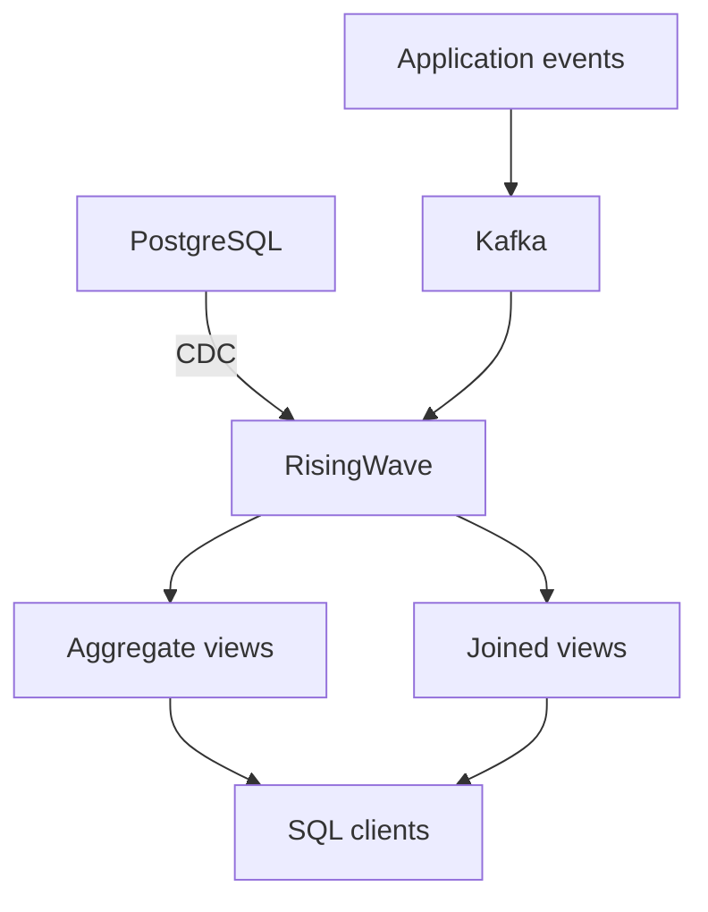
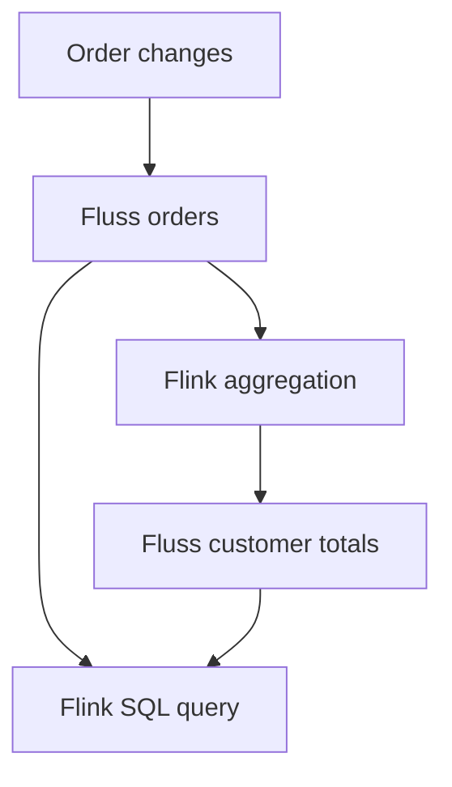
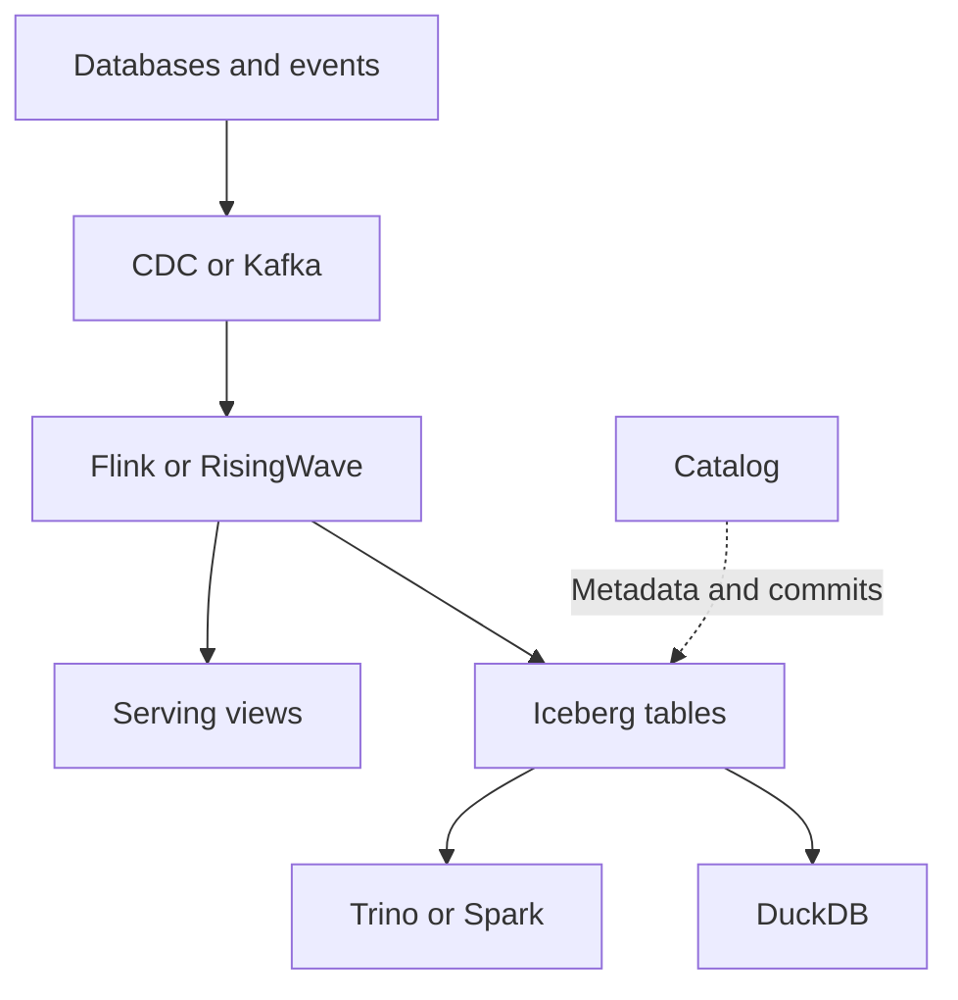

# 構成を選ぶ

新しい製品を並べる前に、log、compute、storage、servingの役割を分けます。
Flinkはstateful compute、Flussはstreaming storageです。
RisingWaveとMaterializeは継続計算した結果をSQLで参照できるstreaming databaseです。

| 条件 | 第一候補 | 判断理由 |
|---|---|---|
| 任意ロジック、event time、複雑なstateful処理 | Kafka + Flink | 演算と状態管理を細かく設計できる |
| SQL集計と結果参照を少ない部品で構築 | Kafka/CDC + RisingWave | 取り込み・増分計算・servingを集約 |
| SQLビューをアプリケーションから継続参照 | Materialize | 増分ビューを中心に設計できる |
| SQLによる軽量なstream processingを試す | Arroyo | Rust実装、Kafka入出力、windowなど |
| 変更される表をストリームとして共有 | Fluss + Flink | 主キー付きstorageと演算を分離 |
| 長期保存、複数query engine、再計算 | Iceberg/Paimonを含むlakehouse | オープンなtable formatとsnapshot管理 |

この表は選定の出発点です。新しさだけで性能・運用負荷・コストの優劣は決まりません。

## Streaming database

このリポジトリの主要構成です。Kafkaを残す理由はretention、replay、複数consumerです。
DB変更を直接取り込む枝にはKafkaがありません。

## Flink + Fluss

`examples/fluss` はこの実線部分を構成するSQLとComposeです。
FlussはFlinkを置き換えません。SQLの計算とstorageの役割が異なります。
FlussとKafkaのwire protocol互換も前提にしていません。

## Streaming lakehouse

これは発展構成の設計図です。上記全経路を本リポジトリで結合試験したものではありません。
`examples/iceberg` では、table metadata・data files・snapshot・照会を有限fixtureで体験します。
RisingWaveからの継続sinkにはcatalogとobject storageを追加します。
[公式sink設定](https://docs.risingwave.com/iceberg/deliver-to-iceberg)

Icebergはquery engineではありません。catalogはcurrent metadataの参照とcommitを管理し、
object storageに実データとmetadataが置かれます。small files、compaction、snapshot expiration、
update/delete形式に対する読み手の対応が重要です。

## 可観測性

OpenTelemetry collectorとPrometheus/Mimir、Loki、Tempoを使う構成は、一般的なmetrics/logs/traces向けです。
本例のKafkaによるイベント監視とは目的が重なる部分もありますが、同一システムではありません。
[OpenTelemetry Collector](https://opentelemetry.io/docs/collector/)
