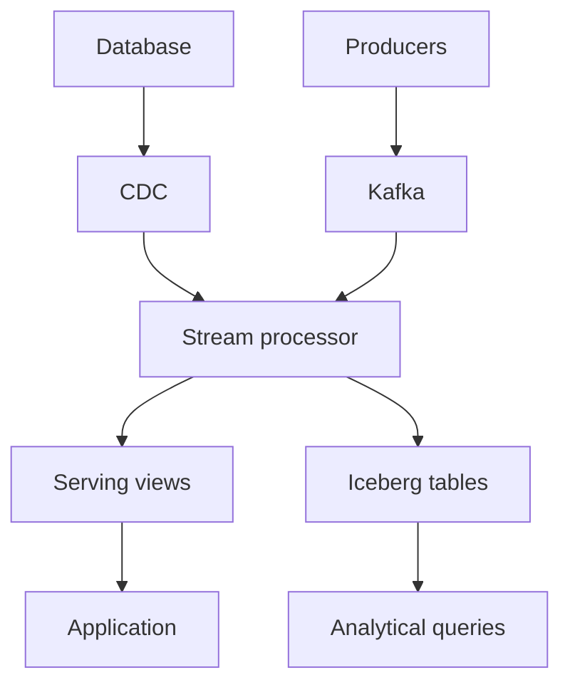

# Design a Real-Time Event Platform

## 30-sec summary

I use Kafka to retain events and support replay. I use Flink for complex stateful processing,
or a streaming database for SQL views. I store long-term data in Iceberg when we need open analytical storage.
I choose each component based on latency, replay, state, and serving requirements.

## Clarifying questions

- What is the peak event rate and average event size?
- What is the latency target?
- How long do we need to replay events?
- Do we need event-time windows and late events?
- Are the results used by dashboards or user-facing requests?
- Which external side effects must happen only once?

## Requirements

- Ingest events and database changes.
- Maintain aggregates and derived state.
- Handle duplicates and out-of-order events.
- Recover after a process failure.
- Support replay and migration checks.

## High-level design

## Deep dive 1

I partition by the entity key when per-entity order matters.
Kafka preserves order within a partition. It does not provide a global order across all partitions.
For rough storage sizing, I multiply events per second, bytes per event, retention seconds, and replication factor.
Then I include compression, indexes, and operating headroom.

## Deep dive 2

I separate event time from processing time. A watermark estimates event-time progress.
I define how late data changes a result and how long we keep state.
The RisingWave lab uses revisable minute buckets. The Flink lab uses watermark-based windows.
They do not have the same finalization rules.

## Deep dive 3

I write the business change and outbox row in one database transaction.
The publisher may send a record twice after a crash.
The consumer writes its inbox and projection in one transaction, then commits the Kafka offset.
An entity version prevents an old update from replacing a newer value.
I keep the delete version so old events cannot recreate deleted data.

## Tradeoffs

| Choice | Benefit | Cost |
|---|---|---|
| Flink | Flexible stateful processing | More application and cluster operations |
| Streaming database | SQL processing and serving together | Product-specific SQL and scaling constraints |
| Fluss | Shared streaming tables | Additional storage operations and connector choices |
| Iceberg | Open tables and snapshots | Catalog, compaction, and commit latency |

## Failure cases

- Broker failure: replicas and producer acknowledgements matter. The local lab has one broker.
- Consumer crash: replay starts from the committed offset.
- Crash after target commit: the inbox detects the duplicate.
- Late delete or update: the entity version decides which state wins.
- CDC outage: monitor replication lag and retained WAL.
- Expired Kafka offsets: backfill and reconcile; do not silently skip missing history.
- Hot partition: improve the key design or split the hot entity's workload when semantics allow it.

## 2-min English answer

I would first confirm the event rate, latency target, retention, and query patterns.

I would use Kafka when we need a durable event log, replay, and independent consumers.
I would partition by an entity key, such as an order ID.

For processing, I would use Flink when we need custom state, event-time windows, or complex logic.
For SQL aggregates and serving views, I would also consider RisingWave or Materialize.
They combine incremental processing and SQL serving in one system.

Fluss has a different role. It is streaming storage that can work with Flink.
It is not a replacement for Flink's processing engine.

For long-term analytics, I would write to Iceberg and choose a query engine separately.
I would also plan catalog operations, compaction, and snapshot retention.

For delivery guarantees, I would examine each boundary.
A checkpoint does not make every external side effect exactly once.
I would use an outbox for database changes and an idempotent consumer for the target.
The consumer would commit the target transaction before committing the Kafka offset.

Finally, I would test duplicates, late events, deletes, recovery, and replay.
For migration, I would reconcile the source and target before switching traffic.
