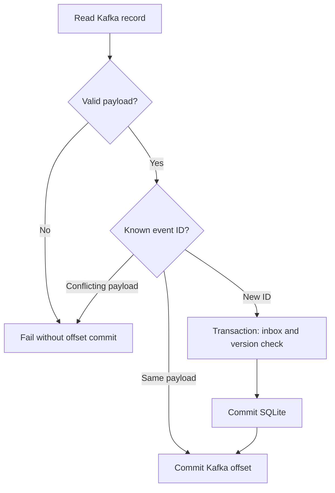

# Delivery semantics and migration

## 保証する範囲

| 境界 | この実装の挙動 | 限界 |
|---|---|---|
| producer → Kafka | idempotent producer、acks=all、配送callback確認 | 別sessionでの業務イベント再送は重複し得る |
| PostgreSQL → outbox | 同一transaction、entity単位advisory lock | 直接DBを書き換える別writerはoutboxを経由しない |
| outbox → Kafka | ack後にpublished_at更新 | Kafka ack後・PG commit前の障害で重複 |
| Kafka → SQLite | inboxとprojectionを同じtransactionでcommit | DB volumeを失えばinboxも消える |
| SQLite → offset | DB commit成功後だけoffset commit | 間の障害は再配送になる |
| entityの順序 | versionが大きい変更だけ適用 | versionはsource側で一意に増加させる必要 |
| 削除 | tombstoneとしてversion保持 | 無期限保存は増大する。削除時期はretentionと再送期間に依存 |

end-to-end exactly-onceを一括で主張しません。
学べるのはat-least-once配送とidempotent effectの組み合わせです。
Flink例のcheckpoint設定もKafka sinkへのexactly-once出力を保証しません。

## 異常時の流れ

SQLite commit後に停止しても、次の配送では同じevent IDがinboxにあるので副作用を繰り返しません。
不正payload・同一versionの競合は停止します。DLQ・修正再投入の運用は未実装です。

## Consumerの範囲

このconsumerは起動時に全partitionのend offsetを取得し、その位置まで読む有限のバッチです。
通常はgroupのcommitted offsetから再開し、replayでは保持中の先頭から読み直します。
**一度に1プロセスだけ実行**してください。`assign()` を使うためgroup rebalanceによる
複数worker分担は実装していません。topic partition数の変更も実行中は扱いません。

起動後に増えたイベントは次の実行の対象です。source更新を止めて、publish、consume、
reconciliationの順に実行すれば、デモでの照合範囲が確定します。
retentionで失ったoffsetは通常実行でエラーにし、黙って欠損を飛ばしません。
replayは保持中のデータしか読めないため、retention前の完全復元は保証しません。

## 本番で追加する移行手順

1. sourceを唯一のwriterにし、初期snapshotとCDCの開始位置を整合させる。
2. snapshotをbackfillし、その間の変更をbufferして適用する。
3. entity versionとdeleteを扱い、件数だけでなくキー別checksumや集計を比較する。
4. 旧sourceへの書き込みをfenceし、確定したoffset/LSNまで追いつく。
5. 再照合後にread/write routingを切り替える。
6. ロールバック期間のreverse replicationや旧側read-only維持を決める。

Kafkaがあるだけではsnapshot競合やcutoverの問題は解決しません。
このコードは手順2の大規模backfillと手順4〜6を自動化しません。

## Stateと運用コスト

主要SQLのDISTINCT、累積推薦、履歴集計、SQLite inboxは無期限に増えます。
本番ではretention、watermark、allowed lateness、TTLを業務要件と揃えます。
checkpointの成功だけでなくconsumer lag、WAL保持量、state size、sink commit遅延も監視します。
